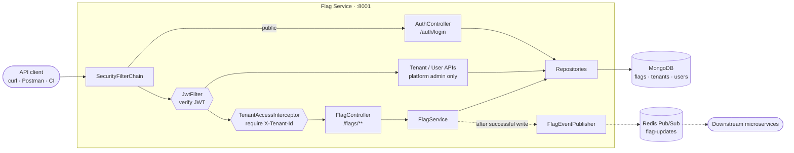

# Flag Service

A multi-tenant feature-flag service. One deployment serves many customers, and
each tenant can only read or change its own flags. Every change is published to
downstream services over Redis Pub/Sub.

**Stack:** Spring Boot 3.2 · Java 21 · MongoDB · Redis · JWT · BCrypt

---

## Overview

The Flag Service is the control plane for boolean feature flags. It stores the
authoritative flag state, authenticates callers with JWTs, partitions all data
by tenant, and announces changes so downstream services can evaluate flags
locally instead of calling the API on every request.

|                |                                                                                            |
| -------------- | ------------------------------------------------------------------------------------------ |
| **Port**       | `8001`                                                                                     |
| **Flag store** | MongoDB `flags` collection (one document per tenant + name)                                |
| **Accounts**   | MongoDB `users` collection, BCrypt password hashes, roles `PLATFORM_ADMIN` / `TENANT_USER` |
| **Tenants**    | MongoDB `tenants` collection                                                               |
| **Events**     | Redis channel `flag-updates`                                                               |
| **API docs**   | Swagger UI at `/swagger-ui.html`                                                           |

---

## Architecture



Writes always go to MongoDB first and Redis second. A Redis outage never fails
the request and never produces a phantom event.

---

## Features

- **Tenant isolation** — every flag query is scoped by `tenantId`; an id from
  another tenant returns `404`.
- **Mandatory tenant header** — every `/flags/**` request must send
  `X-Tenant-Id`; missing → `400`, another tenant's id → `403`.
- **Role-based access** — `PLATFORM_ADMIN` manages tenants/users and may target
  any tenant; `TENANT_USER` is restricted to its own tenant.
- **Database-backed auth** — users live in MongoDB with BCrypt hashes; JWTs
  carry `sub`, `tenantId`, and `role` claims.
- **Flag CRUD** — create, list, get by name, update by id, delete by id.
- **Soft delete** — deleted flags keep their document (`deletedAt`) but free the
  name for reuse.
- **Versioning and audit** — each flag has a `version` plus
  `createdBy` / `updatedBy`.
- **Tenant cascade delete** — deleting a tenant removes all of its flags and
  users.
- **Change propagation** — `created` / `updated` / `deleted` events on
  `flag-updates`, including `tenantId` and `version`.
- **Legacy migration** — existing flags are moved to a `default` tenant on
  startup; the old globally-unique name index is replaced with
  `(tenantId, name)`.
- **OpenAPI docs** — Swagger UI and JSON spec are generated automatically.

---

## Limitations

- Flags are **boolean only** — no strings, numbers, or JSON payloads.
- No server-side **evaluation endpoint**; consumers cache flags and evaluate
  locally.
- Redis Pub/Sub is **fire-and-forget**: no replay, so a consumer that is offline
  misses events and must re-fetch a snapshot.
- One shared channel (`flag-updates`); consumers must filter by `tenantId`.
  There are no per-tenant channels yet.
- Limited user management: create only — no list, update, role change, or delete.
- Changing `ADMIN_USERNAME` / `ADMIN_PASSWORD` after first startup does **not**
  update the seeded account; delete or edit the user document to reset it.
- No API keys; long-running services must log in with a user and refresh an
  expiring JWT (max `86400` seconds).
- Platform admins may target any tenant via the header (intentional support
  access).
- Tenant deletion is **irreversible** and cascades to flags and users.

---

## Swagger

Start the service, then open:

- **Swagger UI:** <http://localhost:8001/swagger-ui.html>
- **OpenAPI JSON:** <http://localhost:8001/v3/api-docs>

Using Swagger:

1. `POST /auth/login` with the bootstrap admin credentials.
2. Click **Authorize** and paste the returned `token`.
3. For `/flags` operations, fill in the required `X-Tenant-Id` parameter.

---

## Registering a downstream service with Redis

A downstream microservice needs two things: a snapshot of the flags it cares
about, and a live subscription for changes.

### 1. Provision a tenant and a service account

```bash
# Log in as the platform admin (seeded from ADMIN_USERNAME / ADMIN_PASSWORD)
ADMIN_TOKEN=$(curl -s -X POST http://localhost:8001/auth/login \
  -H 'Content-Type: application/json' \
  -d '{"username":"admin","password":"admin"}' | jq -r .token)

# Create a tenant
TENANT_ID=$(curl -s -X POST http://localhost:8001/tenants \
  -H "Authorization: Bearer $ADMIN_TOKEN" \
  -H 'Content-Type: application/json' \
  -d '{"name":"acme"}' | jq -r .id)

# Create a service account bound to that tenant
curl -s -X POST http://localhost:8001/users \
  -H "Authorization: Bearer $ADMIN_TOKEN" \
  -H 'Content-Type: application/json' \
  -d "{\"username\":\"acme-service\",\"password\":\"change-me\",\"tenantId\":\"$TENANT_ID\"}"
```

### 2. Configure the downstream service

| Variable                            | Value                                                   |
| ----------------------------------- | ------------------------------------------------------- |
| `FLAGS_SERVICE_URL`                 | `http://flag-service:8001` (compose) or your public URL |
| `FLAGS_TENANT_ID`                   | the tenant id from step 1                               |
| `FLAGS_USERNAME` / `FLAGS_PASSWORD` | the service account from step 1                         |
| `FLAGS_SNAPSHOT_REFRESH_MS`         | snapshot/JWT refresh interval, default `300000`         |
| `SPRING_DATA_REDIS_URL`             | the same Redis instance the Flag Service publishes to   |

### 3. Subscribe and hydrate a local cache

In the downstream service:

1. Add `spring-boot-starter-data-redis` (and `spring-boot-starter-web` if it is
   not already a web service).
2. Point `spring.data.redis.url` at the same Redis instance the Flag Service
   publishes to.
3. On startup, log in with the service account via `POST /auth/login`, then call
   `GET /flags` with `Authorization: Bearer <token>` and
   `X-Tenant-Id: <tenant id>` to load the snapshot into memory.
4. Register a listener on the `flag-updates` channel (for example with
   `RedisMessageListenerContainer`).
5. For each message, parse the JSON, ignore events whose `tenantId` is not
   yours, and ignore versions you have already seen. Then set the flag in the
   local map, or remove it when `event` is `deleted`.
6. Keep the token and snapshot fresh by re-logging in and re-fetching the
   snapshot periodically, below the JWT lifetime.

### 4. Recover after a disconnect

Redis Pub/Sub does not replay messages. Whenever the subscriber reconnects — or
on startup — re-fetch the snapshot to close the gap.
`RedisMessageListenerContainer` reconnects to Redis automatically.

Keep the periodic snapshot interval below `JWT_EXPIRY_SECONDS` so the cached
token never expires between refreshes.

### 5. Event contract

```json
{
  "tenantId": "66f0acme",
  "name": "checkout-v2",
  "value": true,
  "version": 4,
  "ts": "2026-10-18T12:34:56.789Z",
  "event": "updated"
}
```

`event` is `created`, `updated`, or `deleted`; deletions carry `"value": null`.
Discard events for other tenants and versions you have already seen.

---

## API at a glance

All routes need `Authorization: Bearer <token>` except `/auth/login`.
Routes under `/flags` also need `X-Tenant-Id`.

| Method   | Path            | Purpose                                                    |
| -------- | --------------- | ---------------------------------------------------------- |
| `POST`   | `/auth/login`   | Exchange credentials for a JWT                             |
| `POST`   | `/tenants`      | Create a tenant (platform admin)                           |
| `GET`    | `/tenants`      | List tenants (platform admin)                              |
| `GET`    | `/tenants/{id}` | Get a tenant (platform admin)                              |
| `DELETE` | `/tenants/{id}` | Delete a tenant, its flags, and its users (platform admin) |
| `POST`   | `/users`        | Create a tenant-bound user (platform admin)                |
| `POST`   | `/flags`        | Create a flag in the header's tenant                       |
| `GET`    | `/flags`        | List that tenant's live flags                              |
| `GET`    | `/flags/{name}` | Get a flag by name in that tenant                          |
| `PATCH`  | `/flags/{id}`   | Update a flag's value by id                                |
| `DELETE` | `/flags/{id}`   | Soft-delete a flag by id                                   |

### Flag example

```bash
# Create
curl -X POST http://localhost:8001/flags \
  -H "Authorization: Bearer $TOKEN" \
  -H "X-Tenant-Id: $TENANT_ID" \
  -H 'Content-Type: application/json' \
  -d '{"name":"checkout-v2","value":false}'

# Update by id
curl -X PATCH http://localhost:8001/flags/$FLAG_ID \
  -H "Authorization: Bearer $TOKEN" \
  -H "X-Tenant-Id: $TENANT_ID" \
  -H 'Content-Type: application/json' \
  -d '{"value":true}'

# Delete by id
curl -X DELETE http://localhost:8001/flags/$FLAG_ID \
  -H "Authorization: Bearer $TOKEN" \
  -H "X-Tenant-Id: $TENANT_ID"
```

A flag response:

```json
{
  "id": "6650f1c2e4b0a1d3f8a91b23",
  "tenantId": "66f0acme",
  "name": "checkout-v2",
  "value": true,
  "version": 4,
  "createdAt": "2026-10-18T12:00:00Z",
  "updatedAt": "2026-10-18T12:34:56Z"
}
```

---

## Run locally

```bash
docker compose up --build
```

MongoDB, Redis, and the Flag Service start together. Then open
<http://localhost:8001/swagger-ui.html>.

Required environment variables: `JWT_SECRET` (32+ bytes). The bootstrap
platform admin uses `ADMIN_USERNAME` / `ADMIN_PASSWORD` (defaults `admin` /
`admin`) on first startup only.
