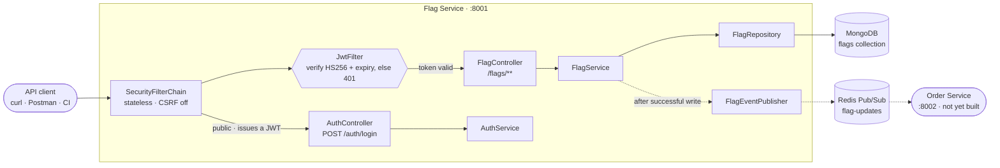
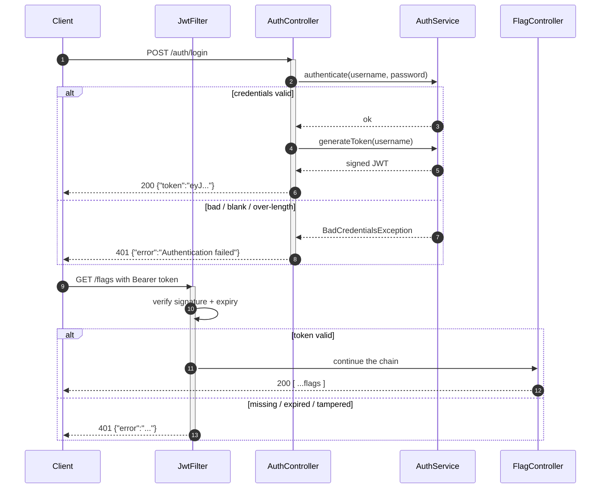
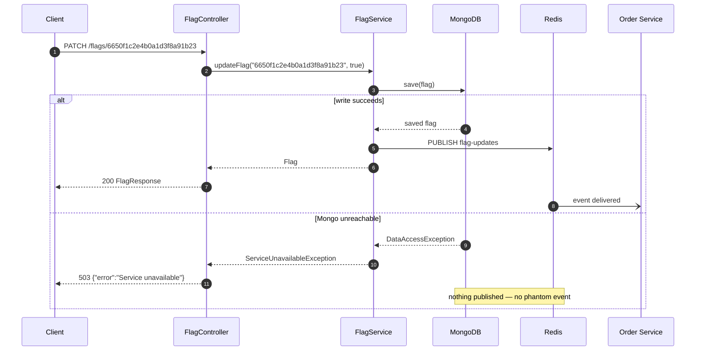
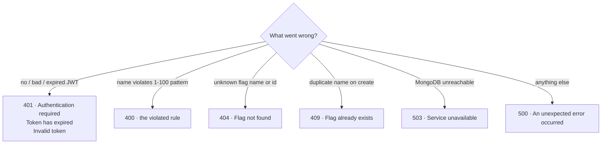

<div align="center">

# Flag Service

**Feature-flag management REST API**

Spring Boot 3.2 · Java 21 · MongoDB · Redis Pub/Sub · JWT

[](https://openjdk.org/projects/jdk/21/)
[](https://spring.io/projects/spring-boot)
[](https://www.mongodb.com/)
[](https://redis.io/)

**Exposed port: `8001`** — the Docker image declares `EXPOSE 8001`

</div>

---

## Contents

| | |
|---|---|
| **[Overview](#overview)** | What the service is and what it is not |
| **[Architecture](#architecture)** | Request flow at a glance |
| **[Authentication](#authentication)** | Login and token verification |
| **[Flag change propagation](#flag-change-propagation)** | Write path out to Redis |
| **[Quick start](#quick-start)** | Run it in under two minutes |
| **[API reference](#api-reference)** | Every endpoint, expandable |
| **[Error handling](#error-handling)** | Status codes and error bodies |
| **[Configuration](#configuration)** | The single config file and environment variables |
| **[Docker](#docker)** | Build and run the image |
| **[Project structure](#project-structure)** | Where things live |
| **[Troubleshooting](#troubleshooting)** | Common failures |

> Every collapsible section below (`▶`) can be clicked to expand. The diagrams
> are rendered by GitHub and support hover, zoom, and pan.

---

## Overview

The Flag Service is the control plane of the FF Project feature-flag platform. It
owns the authoritative flag state and announces every change to the rest of the
system over Redis Pub/Sub.

| | |
|---|---|
| **Stores** | Boolean flags in a MongoDB `flags` collection |
| **Secures** | Every `/flags/**` route with a stateless HS256 JWT |
| **Publishes** | `{"name":…,"value":…,"event":…}` on the `flag-updates` channel |
| **Documents** | Itself at `/swagger-ui.html` |

**Out of scope:** the consumer (Order Service), a frontend dashboard, CI/CD, and
percentage rollouts. Flags are strictly boolean.

---

## Architecture

A request passes through exactly one security checkpoint before it can touch any
flag data. Writes reach MongoDB first and Redis second, so a Redis outage can
never produce a phantom change event.



<details>
<summary><strong>The three layers, and why each exists</strong></summary>

<br/>

1. **`SecurityFilterChain` + `JwtFilter`** — there is no session and no login
   state. A single filter verifies the token's signature and expiry and rejects
   the request with a JSON `401` before any controller runs. Nothing downstream
   needs to know about authentication.
2. **Controllers** — `AuthController` and `FlagController` are deliberately thin.
   They never catch exceptions; all failure translation happens in
   `GlobalExceptionHandler`, which keeps the status-code policy in exactly one
   place.
3. **`FlagService`** — owns the business rules. It is the only place that knows a
   duplicate name means `409`, a missing flag means `404`, and a Mongo outage
   means `503`. It also enforces the ordering guarantee: **persist first,
   announce second.**

</details>

---

## Authentication

`POST /auth/login` exchanges admin credentials for a signed JWT. Every failure
mode returns the *same* generic body, so a caller can never learn which field was
wrong.



| Rejection reason | Body |
|---|---|
| No `Authorization` header, or not `Bearer …` | `{"error":"Authentication required"}` |
| Token expired | `{"error":"Token has expired"}` |
| Token malformed, tampered, or wrong signature | `{"error":"Invalid token"}` |
| Bad credentials at login | `{"error":"Authentication failed"}` |

The three `401` bodies above come from `JwtFilter`; the login failure comes from
`AuthController`. Both bypass `GlobalExceptionHandler` for this case, because
credential problems must map to `401` rather than the generic `400`.

---

## Flag change propagation

Redis publication is **fire-and-forget and strictly after the database write**.
If Mongo fails, the client gets a `503` and nothing is published. If Redis fails,
the client still gets a success response — the flag *is* persisted — and the
failure is logged at `WARN`.



The published payload:

```json
{ "name": "checkout-v2", "value": true, "event": "updated" }
```

`event` is one of `created`, `updated`, or `deleted`. Deletions carry
`"value": null`.

---

## Quick start

<details open>
<summary><strong>Docker Compose — everything in one command</strong></summary>

<br/>

Requires Docker. MongoDB and Redis are provisioned for you; nothing needs to be
installed locally.

```bash
cd "/path/to/FF Project"

# Build the service image and start Mongo, Redis, and the API
docker compose up --build

# Flag Service is ready when it reports healthy
docker compose ps
```

Then open <http://localhost:8001/swagger-ui.html>, or grab a token:

```bash
curl -s http://localhost:8001/auth/login \
  -H 'Content-Type: application/json' \
  -d '{"username":"admin","password":"admin"}'
```

Stop everything with `docker compose down`, or wipe the database too with
`docker compose down -v`.

</details>

<details>
<summary><strong>From an IDE — databases in Docker, service on the host</strong></summary>

<br/>

```bash
# Start just the databases
docker compose up -d mongo redis

# Export the required secret (32+ bytes for HS256)
export JWT_SECRET="local-development-secret-change-me-please-32b"

# The localhost defaults already point at those containers
./mvnw spring-boot:run
```

On Windows PowerShell, set the variable with
`$env:JWT_SECRET = "local-development-secret-change-me-please-32b"` instead.

</details>

<details>
<summary><strong>Swagger UI — explore and call the API</strong></summary>

<br/>

1. Open <http://localhost:8001/swagger-ui.html>.
2. Run `POST /auth/login`, copy the `token` from the response.
3. Click **Authorize** (top right), paste the token, and confirm.
4. Every `/flags` operation is now callable from the browser.

</details>

---

## API reference

Base URL: `http://localhost:8001`. Everything under `/flags` requires
`Authorization: Bearer <token>`.

| Method | Path | Success | Purpose |
|---|---|---|---|
| `POST` | `/auth/login` | `200` | Exchange credentials for a JWT |
| `POST` | `/flags` | `201` | Create a flag |
| `GET` | `/flags` | `200` | List all flags |
| `GET` | `/flags/{name}` | `200` | Fetch one flag by name |
| `PATCH` | `/flags/{id}` | `200` | Update a flag's value by id |
| `DELETE` | `/flags/{id}` | `204` | Delete a flag by id |

A flag resource looks like this:

```json
{
  "id": "6650f1c2e4b0a1d3f8a91b23",
  "name": "checkout-v2",
  "value": true,
  "createdAt": "2026-10-18T12:00:00Z",
  "updatedAt": "2026-10-18T12:34:56Z"
}
```

<details>
<summary><strong><code>POST /auth/login</code></strong> — issue a JWT</summary>

<br/>

```bash
curl -X POST http://localhost:8001/auth/login \
  -H 'Content-Type: application/json' \
  -d '{"username":"admin","password":"admin"}'
```

`200`:

```json
{ "token": "eyJhbGciOiJIUzI1NiJ9..." }
```

`401` for bad credentials, blank fields, username over 64 characters, or password
over 128 characters.

</details>

<details>
<summary><strong><code>POST /flags</code></strong> — create a flag</summary>

<br/>

The name must match `^[a-zA-Z0-9\-_]{1,100}$`.

```bash
curl -X POST http://localhost:8001/flags \
  -H "Authorization: Bearer $TOKEN" \
  -H 'Content-Type: application/json' \
  -d '{"name":"checkout-v2","value":false}'
```

| Status | When |
|---|---|
| `201` | Created — a `created` event is published |
| `400` | Name is blank or violates the pattern; body carries the violated rule |
| `401` | Missing or invalid token |
| `409` | A flag with that name already exists |
| `503` | MongoDB is unreachable |

</details>

<details>
<summary><strong><code>GET /flags</code></strong> — list all flags</summary>

<br/>

```bash
curl http://localhost:8001/flags -H "Authorization: Bearer $TOKEN"
```

Always `200`. Returns `[]` when no flags exist, and never touches Redis.

</details>

<details>
<summary><strong><code>GET /flags/{name}</code></strong> — fetch one flag</summary>

<br/>

```bash
curl http://localhost:8001/flags/checkout-v2 -H "Authorization: Bearer $TOKEN"
```

`200` with the flag, or `404 {"error":"Flag not found"}`.

</details>

<details>
<summary><strong><code>PATCH /flags/{id}</code></strong> — update a flag</summary>

<br/>

The flag is addressed by its server-assigned `id`, not its name.

```bash
curl -X PATCH http://localhost:8001/flags/6650f1c2e4b0a1d3f8a91b23 \
  -H "Authorization: Bearer $TOKEN" \
  -H 'Content-Type: application/json' \
  -d '{"value":true}'
```

`200` with the updated flag, or `404` if no such flag exists. Publishes an
`updated` event (carrying the flag's `name`) only after the write succeeds.

</details>

<details>
<summary><strong><code>DELETE /flags/{id}</code></strong> — delete a flag</summary>

<br/>

The flag is addressed by its server-assigned `id`, not its name.

```bash
curl -X DELETE http://localhost:8001/flags/6650f1c2e4b0a1d3f8a91b23 \
  -H "Authorization: Bearer $TOKEN"
```

`204` with an empty body, or `404` if no such flag exists. Publishes a `deleted`
event with `"value": null`.

</details>

---

## Error handling

Every controller error funnels through `GlobalExceptionHandler`, which returns a
single-key JSON envelope: `{"error": "..."}`.



| Status | Body | Raised by |
|---|---|---|
| `400` | The violated field constraint | Bean validation on the request body |
| `401` | `Authentication required` / `Token has expired` / `Invalid token` | `JwtFilter` |
| `401` | `Authentication failed` | `AuthController` (login only) |
| `404` | `Flag not found` | `FlagNotFoundException` |
| `409` | `Flag already exists` | `FlagAlreadyExistsException` |
| `503` | `Service unavailable` | `ServiceUnavailableException` — the cause is logged |
| `500` | `An unexpected error occurred` | Catch-all; the stack trace is logged, never returned |

<details>
<summary><strong>Why a duplicate name is <code>409</code> and not a race condition</strong></summary>

<br/>

Uniqueness is enforced by a unique index on `name` in MongoDB, not by a
read-then-write check. Two concurrent `POST`s with the same name therefore cannot
both succeed: the loser gets a `DuplicateKeyException`, which is translated to
`FlagAlreadyExistsException` and returned as `409`. No flag is created or
modified by the losing request.

</details>

---

## Configuration

There is a single configuration file, `application.properties`, and no profiles
to switch between. The same file is used for local testing and for the cloud
deployment — only where the two connection URLs point changes.

Every value below is read from an environment variable, and each one has a
localhost default. With nothing set, the service talks to the MongoDB and Redis
containers from `docker-compose.yml`; export `MONGODB_URI` and `REDIS_URL` to
point it at MongoDB Atlas and Upstash Redis instead, locally or on Render.

### Environment variables

| Variable | Default | Notes |
|---|---|---|
| `SERVER_PORT` | `8001` | Listening port |
| `JWT_SECRET` | *(none)* | **Required.** HS256 signing key, 32+ bytes |
| `JWT_EXPIRY_SECONDS` | `3600` | Must be between `60` and `86400` |
| `ADMIN_USERNAME` | `admin` | Single admin account |
| `ADMIN_PASSWORD` | `admin` | Single admin account |
| `MONGODB_URI` | `mongodb://localhost:27017/ffproject` | Include the database name (`/ffproject`) in the URI |
| `REDIS_URL` | `redis://localhost:6379` | Use `rediss://…` for Upstash; TLS is enabled from the scheme |

Out-of-range `JWT_EXPIRY_SECONDS` makes the service fail at startup rather than
issue tokens with an unusable lifetime. A missing or too-short `JWT_SECRET`
fails at startup as well.

---

## Docker

The image is a two-stage build: Maven compiles the fat JAR, then it is copied
onto a slim Alpine JRE. The Maven wrapper is baked in, so the build pins its own
Maven version.

```bash
docker build -t ffproject/flag-service:local ./flag-service
docker run --rm -p 8001:8001 \
  -e JWT_SECRET="local-development-secret-change-me-please-32b" \
  -e MONGODB_URI="mongodb://host.docker.internal:27017/ffproject" \
  -e REDIS_URL="redis://host.docker.internal:6379" \
  ffproject/flag-service:local
```

**Exposed port: `8001`** (declared via `EXPOSE 8001`). Similarly, the sibling
Order Service is specified to expose `8002`, though it is not built yet.

The container needs no install step at startup — it only runs
`java -jar /app/app.jar`. Tests are skipped during the image build.

---

## Project structure

```
FF Project/
├── docker-compose.yml                 # Mongo + Redis + Flag Service
└── flag-service/
    ├── Dockerfile                     # two-stage build, EXPOSE 8001
    ├── pom.xml
    └── src/main/
        ├── java/com/ffproject/flagservice/
        │   ├── auth/                  # AuthController, AuthService, JwtFilter
        │   ├── config/                # Security, Redis, Mongo, OpenAPI
        │   ├── exception/             # domain exceptions + GlobalExceptionHandler
        │   ├── flag/                  # Flag, FlagRepository, FlagService, FlagController
        │   │   └── dto/               # CreateFlagRequest, UpdateFlagRequest, FlagResponse
        │   └── redis/                 # FlagEventPublisher
        └── resources/
            └── application.properties # the only config file — env vars with localhost defaults
```

---

## Troubleshooting

<details>
<summary><strong>Startup fails with <code>Could not resolve placeholder 'JWT_SECRET'</code></strong></summary>

<br/>

`JWT_SECRET` is not set at all. It has no default on purpose — the service would
rather refuse to start than sign tokens with a guessable key. Export a real
secret of at least 32 bytes:

```bash
export JWT_SECRET="$(openssl rand -base64 48)"
```

</details>

<details>
<summary><strong>Startup fails with <code>WeakKeyException</code></strong></summary>

<br/>

`JWT_SECRET` is set, but shorter than 32 bytes. HS256 is HMAC-SHA256, and
RFC 7518 §3.2 requires the key to be at least as long as the hash output — 256
bits, so 32 bytes. The JWT library enforces this:

```
WeakKeyException: The specified key byte array is 64 bits which is not secure
enough for any JWT HMAC-SHA algorithm.
```

Generate one that is long enough:

```bash
export JWT_SECRET="$(openssl rand -base64 48)"
```

</details>

<details>
<summary><strong>Startup fails with a MongoDB timeout</strong></summary>

<br/>

The service verifies its database connection at startup and exits non-zero if it
cannot connect. Check that the container is up and healthy:

```bash
docker compose ps
docker compose logs mongo
```

When running the service on the host rather than in compose, remember that
`localhost` is correct only for host networking. Inside the compose network the
URLs must use the service names `mongo` and `redis`.

</details>

<details>
<summary><strong>A flag change did not reach a consumer</strong></summary>

<br/>

This is expected to be non-fatal by design. Publishing happens after the write
and never fails the caller's request — a Redis problem leaves the flag persisted
and the HTTP response successful. Look for a `WARN` line:

```
Redis publish failed for flag checkout-v2: ...
```

If you see no such line but also no event, verify the subscriber is listening on
the `flag-updates` channel and that both processes point at the same Redis
instance.

</details>

<details>
<summary><strong>Swagger UI returns 401</strong></summary>

<br/>

The UI itself is public, but `/flags` operations are not. Use **Authorize** and
paste a token from `POST /auth/login`. If the token is older than
`JWT_EXPIRY_SECONDS`, log in again.
</details>
