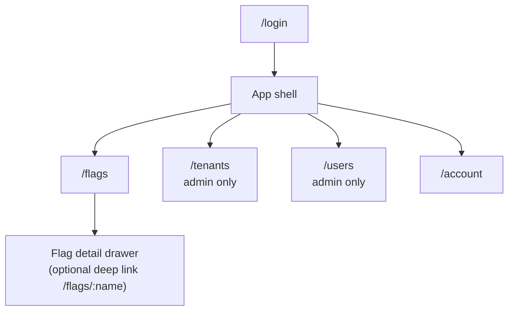
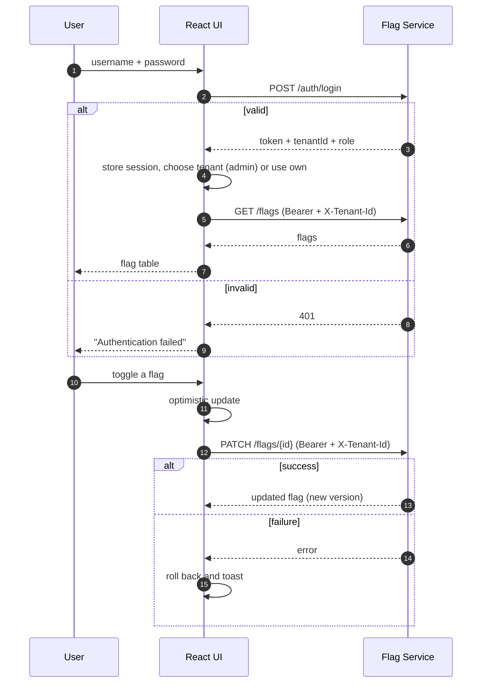

# Plan: React UI for the Flag Service

> Status: proposal. Greenfield frontend — the repository currently contains only
> the Spring Boot `flag-service`. This plan targets the API as it exists today
> and calls out the small backend additions needed for a complete UI.

---

## 1. Purpose and scope

Build a small, fast web UI on top of the Flag Service so people can manage flags
without curl or Swagger.

**In scope (v1):**

- Log in with a username/password and hold the JWT for the session.
- Role-aware navigation (`PLATFORM_ADMIN` vs `TENANT_USER`).
- Tenant context: admins pick a tenant; tenant users are fixed to their own.
- Flag list with search/filter, create, toggle value, copy id, and delete.
- Tenant list/create/delete for platform admins.
- User creation for platform admins.
- Clear loading, empty, validation, and error states.

**Out of scope (v1):**

- Flag evaluation/rollout rules, audit history, bulk import/export.
- User listing/editing/deletion (API does not support it yet — see §10).
- SSO, API keys, refresh tokens.
- A marketing site or public docs.

---

## 2. Users, roles, and permissions

| Action | `PLATFORM_ADMIN` | `TENANT_USER` |
|---|---|---|
| Log in | yes | yes |
| View/manage flags | any tenant (via tenant selector) | own tenant only |
| List/create/delete tenants | yes | no |
| Create users | yes | no |
| Switch tenant in the UI | yes | no (fixed) |

Server-side enforcement is authoritative. The UI hides/disables actions by role,
but must still handle `403` responses gracefully.

---

## 3. Recommended stack

| Concern | Choice | Why |
|---|---|---|
| Build | **Vite + React 18 + TypeScript** | Fast dev server, small bundle |
| Routing | **React Router** | Standard, URL-addressable screens |
| Server state | **TanStack Query** | Caching, retries, invalidation, loading states |
| Client state | **Zustand** (or React Context) | Small auth/tenant/session store |
| Forms | **React Hook Form + Zod** | Validation mirrors API rules |
| Styling | **Tailwind CSS + shadcn/ui** | Fast, accessible primitives |
| Tables | **TanStack Table** | Sorting/filtering without heavy UI lock-in |
| Icons | **lucide-react** | Lightweight, consistent |
| Tests | **Vitest + Testing Library + MSW**, **Playwright** | Unit/integration + E2E |
| Lint/format | **ESLint + Prettier** | Consistency |

No global state library is needed beyond auth/tenant context; TanStack Query owns
all server data.

---

## 4. Information architecture



Routes:

| Route | Access | Purpose |
|---|---|---|
| `/login` | public | Username/password login |
| `/flags` | authenticated | Flag list and all flag actions |
| `/tenants` | platform admin | Tenant list/create/delete |
| `/users` | platform admin | Create a tenant-bound user |
| `/account` | authenticated | Identity, role, tenant, token expiry, logout |
| `*` | authenticated | Not-found page |

Guard: unauthenticated users → `/login` with a `returnTo` param. Non-admins
hitting `/tenants` or `/users` → `/flags` with a toast.

---

## 5. Screens

### 5.1 Login (`/login`)

- Centered card: username, password, submit.
- Show the server's generic `401` message (`Authentication failed`) without
  implying which field was wrong.
- Disable submit while pending; support Enter to submit.
- On success, store `{ token, username, tenantId, role }` and route to `/flags`.
- Show a hint that the bootstrap admin comes from `ADMIN_USERNAME` /
  `ADMIN_PASSWORD` (dev environments only).

### 5.2 App shell

- **Sidebar:** Flags; Tenants and Users only for `PLATFORM_ADMIN`; Account at the
  bottom.
- **Top bar:**
  - `TENANT_USER`: a read-only tenant badge (name when available, otherwise id).
  - `PLATFORM_ADMIN`: a tenant selector populated from `GET /tenants`, plus the
    selected tenant. Selection is required before flag actions.
  - Role badge (`Platform admin` / `Tenant user`) and logout.
- **Responsive:** sidebar collapses to a drawer under ~768px.

### 5.3 Flags (`/flags`)

- Header: title, tenant indicator, **New flag** button.
- Toolbar: search by name, filter All / Enabled / Disabled, refresh.
- Table columns: Name, Value (toggle), Version, Updated, Actions.
  - **Toggle** calls `PATCH /flags/{id}` with `{ value }`; optimistic update with
    rollback on error.
  - **Copy id** for use in API calls.
  - **Delete** opens a confirmation dialog (soft delete; name becomes reusable).
  - Name is immutable — no rename action.
- Row click (or an "open" icon) shows a detail drawer with id, tenant, name,
  value, version, and timestamps.
- Empty state: explain that no flags exist and offer **Create flag**.
- Create dialog: name (pattern `^[a-zA-Z0-9\-_]{1,100}$`), initial value; map
  `409` to "A flag with this name already exists in this tenant".
- All flag requests include `X-Tenant-Id: <effective tenant>`.

### 5.4 Tenants (`/tenants`, platform admin)

- Table: name, id (copy), created date, actions.
- Create dialog: name (same pattern), maps `409` to "Tenant already exists".
- **Delete** is destructive and cascades to the tenant's flags and users. Use a
  confirmation dialog that requires typing the tenant name, and state the
  consequence explicitly.
- After delete, clear the selection if it was the deleted tenant.

### 5.5 Users (`/users`, platform admin)

- v1 is a **create-only** form, because the API has no list/update/delete:
  username, password, tenant selector, role (`TENANT_USER` default,
  `PLATFORM_ADMIN` optional).
- Validate username ≤ 64 and password ≤ 128 characters; map `404` to "Tenant not
  found" and `409` to "Username already exists".
- When listing/editing users is added to the backend (§10), this becomes a
  standard table screen.

### 5.6 Account (`/account`)

- Username, role, tenant id, and token expiry countdown.
- Logout (clear session + query cache).
- If the token expires, redirect to `/login` with a "Session expired" notice.

---

## 6. Key UX flows



Additional flows:

- **Admin onboarding:** login → create tenant → create tenant user → (optionally)
  switch to the tenant → create flag.
- **Session expiry:** any `401` → clear session, redirect to `/login`, preserve
  the current path.
- **Tenant switch:** change the selected tenant → all flag query keys change and
  refetch; clear any open flag drawer.

---

## 7. State and data layer

### Auth/session store (`Zustand`)

```ts
interface Session {
  token: string;
  username: string;
  tenantId: string;   // from the login response
  role: 'PLATFORM_ADMIN' | 'TENANT_USER';
  expiresAt: number;  // decoded from the JWT `exp`
}
```

- **Storage:** `sessionStorage` (survives reload, dies with the tab) and **not**
  `localStorage`, to reduce XSS impact. The token has no refresh mechanism, so
  expire it client-side at `exp` and send the user to `/login`.
- Tenant selection for admins is kept in the store and mirrored in the URL
  (`?tenant=<id>`) so refreshes and shared links keep context.

### API client (`src/lib/api.ts`)

One wrapper around `fetch` that:

1. Prefixes `VITE_API_BASE_URL` (default `/api`, proxied in dev).
2. Adds `Authorization: Bearer <token>` when a session exists.
3. Adds `X-Tenant-Id` for `/flags` requests from the **effective tenant**
   (user's own for tenant users; the selected tenant for admins).
4. Parses the `{ "error": "..." }` envelope on non-2xx and throws a typed
   `ApiError { status, message }`.
5. On `401`: clears the session and redirects to `/login`.
6. On `403/404/409/503`: lets screens show a toast or inline message.

### TanStack Query conventions

| Query key | Endpoint |
|---|---|
| `['flags', tenantId]` | `GET /flags` |
| `['flag', tenantId, name]` | `GET /flags/{name}` |
| `['tenants']` | `GET /tenants` |

- Toggle: optimistic `setQueryData`, rollback on error, invalidate on settle.
- Create/delete: invalidate `['flags', tenantId]`.
- Tenant create/delete: invalidate `['tenants']`.
- `staleTime` ~30s; no polling (live state arrives via Redis for consumers, and
  flags are low-churn). Provide a manual refresh button.
- Never send flag requests without an effective tenant — disable actions and
  show a "Select a tenant" prompt for admins.

---

## 8. API contract used by the UI

| UI action | Call | Headers |
|---|---|---|
| Log in | `POST /auth/login` | — |
| List flags | `GET /flags` | Bearer + `X-Tenant-Id` |
| Create flag | `POST /flags` | Bearer + `X-Tenant-Id` |
| Read flag | `GET /flags/{name}` | Bearer + `X-Tenant-Id` |
| Toggle value | `PATCH /flags/{id}` | Bearer + `X-Tenant-Id` |
| Delete flag | `DELETE /flags/{id}` | Bearer + `X-Tenant-Id` |
| List tenants | `GET /tenants` | Bearer |
| Create tenant | `POST /tenants` | Bearer |
| Delete tenant | `DELETE /tenants/{id}` | Bearer |
| Create user | `POST /users` | Bearer |

Error bodies are always `{ "error": "message" }`. The UI displays that message
where it is safe and specific; otherwise it uses a friendly fallback per status.

---

## 9. Security notes

- Bearer tokens in headers (not cookies), so no CSRF token is needed.
- Treat the JWT claims as display data only; never make authorization decisions
  from client-side role checks. The server enforces everything.
- Tenant users must never be able to edit the tenant header. Derive it from the
  session; only admins get a selector.
- Use `sessionStorage` + expiry, and clear all queries/store on logout.
- Render flag names and tenant names as text (React escapes by default); never
  use `dangerouslySetInnerHTML`.
- Serve over HTTPS; do not log tokens.
- Add a strict Content-Security-Policy at deploy time.

---

## 10. Backend additions needed for a complete UI

These are not blockers for v1, but should be scheduled:

1. **CORS or reverse proxy.** Spring Security has no CORS config. Use a Vite dev
   proxy (`/api` → `http://localhost:8001`) during development and serve the UI
   from the same origin (or a reverse proxy) in production.
2. **User list/update/delete** — `GET /users`, `PATCH /users/{id}`,
   `DELETE /users/{id}` so `/users` can be a real management screen. Also decide
   whether a user may change their own password.
3. **Pagination + search** for `GET /flags` and `GET /tenants`; the UI otherwise
   filters client-side.
4. **Expose audit fields** (`createdBy`, `updatedBy`) in `FlagResponse` for a
   useful "Updated by" column.
5. **Flag history** (`GET /flags/{id}/history`) if undo/audit is wanted.
6. **Session refresh or API keys.** Today a service/human must re-login when the
   JWT expires (max 24h). Either add a refresh endpoint, API keys, or accept a
   forced re-login.
7. **`GET /auth/me`** (optional) to validate a stored token on load instead of
   trusting a decoded `exp`.
8. **`GET /flags/{id}`** (optional) for id-based deep links; name is currently
   the only read key.
9. **Restore soft-deleted flags** (`POST /flags/{id}/restore`) if the UI should
   offer undo.

---

## 11. Project structure

```
ui/
├── index.html
├── vite.config.ts              # dev proxy: /api -> http://localhost:8001
├── src/
│   ├── main.tsx
│   ├── app/
│   │   ├── router.tsx
│   │   └── providers.tsx       # QueryClient, Router, Toaster
│   ├── features/
│   │   ├── auth/               # login page, session store, guards
│   │   ├── flags/              # list, table, create dialog, toggle, drawer
│   │   ├── tenants/            # list, create dialog, delete confirm
│   │   └── users/              # create form
│   ├── components/
│   │   ├── layout/             # AppShell, Sidebar, TopBar
│   │   └── ui/                 # shadcn primitives
│   ├── lib/
│   │   ├── api.ts              # fetch wrapper + typed errors
│   │   ├── jwt.ts              # decode exp/claims for display only
│   │   └── queryClient.ts
│   └── styles/
└── tests/
    ├── integration/            # MSW-backed screen tests
    └── e2e/                    # Playwright
```

Environment:

```bash
VITE_API_BASE_URL=/api
```

Dev proxy in `vite.config.ts`:

```ts
server: {
  proxy: { '/api': { target: 'http://localhost:8001', changeOrigin: true, rewrite: p => p.replace(/^\/api/, '') } }
}
```

---

## 12. UX and design conventions

- Boolean value shown as a switch **and** a text label (`Enabled` / `Disabled`),
  never color alone.
- Optimistic toggles; on failure, snap back and toast the server message.
- Every destructive action has a confirmation dialog; tenant deletion requires
  typing the name.
- Copy buttons for tenant id and flag id.
- Skeletons for initial loads; inline errors with a retry button.
- Toasts for transient results; inline field errors for forms.
- Keyboard: Enter submits dialogs, Escape closes, focus trapped in dialogs, and
  focus returns to the trigger on close.
- Empty states explain the next action instead of showing a blank table.
- Use the server's error text where specific (`Flag already exists`), and a
  friendly generic message otherwise.

---

## 13. Testing plan

| Level | Tool | Coverage |
|---|---|---|
| Unit | Vitest | `api.ts` (headers, error mapping, 401), `jwt.ts`, validation schemas |
| Integration | RTL + MSW | Login, role-based nav, flag create/toggle/delete, tenant delete confirm, tenant switch |
| E2E | Playwright | Admin onboarding (tenant → user → flag), tenant-user happy path, session expiry |
| A11y | `axe-core` in RTL/E2E | Login, flags table, dialogs |

Critical cases:

- Missing tenant (admin has not selected one) blocks flag actions.
- `401` anywhere logs out and preserves `returnTo`.
- `403` (tenant mismatch) shows a clear message and does not mutate local state.
- Optimistic toggle rolls back on `503`.
- Duplicate flag/tenant/user names surface `409` messages.
- Tenant user never sees Tenants/Users nav or a tenant selector.

---

## 14. Delivery phases

| Phase | Deliverable | Done when |
|---|---|---|
| **0 — Scaffold** | Vite/TS/Tailwind/shadcn, router, providers, API client, auth store, login + shell | Log in, see role-aware shell, log out |
| **1 — Flags** | Flag table, search/filter, create dialog, toggle, delete, detail drawer | Full flag CRUD works against the API |
| **2 — Admin** | Tenant list/create/delete, tenant selector, user create form | Admin can onboard a tenant and user end-to-end |
| **3 — Polish** | Empty/error states, a11y pass, responsive layout, toasts, tests | Integration + E2E suites pass |
| **4 — Follow-ups** | Consume backend gaps in §10 (users list, pagination, history) | UI matches the expanded API |

Phases 0–3 ship against today's API with no backend changes.

---

## 15. Open decisions

1. **UI library** — shadcn/ui (proposed) vs MUI vs plain Tailwind.
2. **Token persistence** — `sessionStorage` (proposed) vs memory-only (forces
   re-login on refresh) vs adding a refresh endpoint.
3. **Admin UX** — explicit tenant selector (proposed) vs a combined
   "tenant → flags" drill-down from the Tenants screen.
4. **Flag detail** — drawer (proposed) vs dedicated route.
5. **First release audience** — platform admins only vs both roles.
6. **Deployment** — serve the SPA from Spring Boot static resources, a separate
   static host, or a reverse proxy (affects CORS).

---

## 16. Acceptance criteria (v1)

- A user can log in and is routed by role; invalid credentials show a generic
  error.
- A tenant user sees only their own tenant's flags and cannot change the tenant.
- A platform admin can select a tenant, and every flag request carries that
  tenant id.
- Flags can be listed, searched, created, toggled, and deleted; duplicate names
  and validation errors are shown clearly.
- A platform admin can create a tenant, create a user in it, and delete a tenant
  with a destructive confirmation that names the cascade.
- Expired/invalid sessions return the user to `/login` without losing the
  intended destination.
- No secret is persisted in `localStorage`; no flag request is made without a
  tenant.
- Lint, unit/integration tests, and the Playwright happy paths pass.
